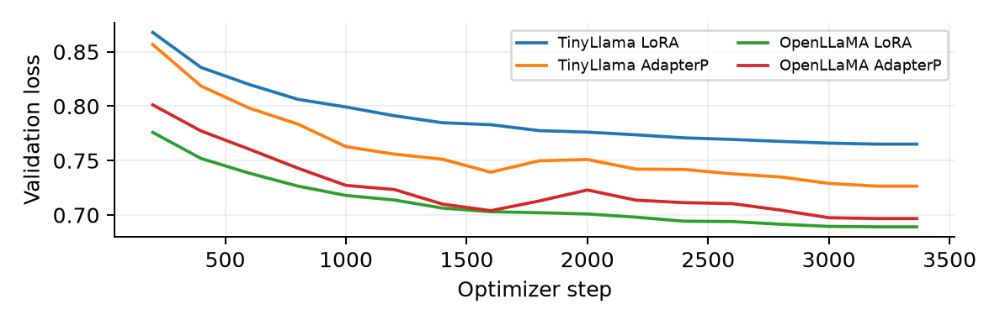

# LLM Post-Training for Mathematical Reasoning

**English** | [简体中文](README.zh-CN.md)

A reproducible supervised fine-tuning and evaluation project comparing **LoRA** and **AdapterP** on **TinyLlama 1.1B** and **OpenLLaMA 3B**. The workflow covers dataset auditing, GPU training, checkpoint recovery, benchmark evaluation and output-level error analysis.

**4 training runs · 12 full benchmark evaluations · 3,894 verified predictions**

[Report PDF](GPU/report/AI6130-Ass2-G2605698H.pdf) · [Detailed experiment write-up](docs/EXPERIMENT_REPORT.md) · [Results CSV](GPU/results/final/summary.csv) · [Weights and evidence](https://github.com/hihihiddssa/LLM-Post-Training-for-Mathematical-Reasoning/releases/tag/experiments-2026-11-01)

## Engineering work

- Built a shared training protocol with fixed model revisions, dataset hashes and train/validation indices.
- Adapted the instructor's PEFT implementation to a pinned Transformers environment, including adapter save/load and optimizer/RNG checkpoint recovery.
- Diagnosed non-finite FP16 gradients and used BF16 base weights with FP32 adapters consistently across all four runs.
- Executed PBS GPU jobs on NSCC A100s and retained actual parameter counts, losses, timings and peak allocated memory.
- Implemented resumable, identity-checked prediction journals with raw generations, per-item correctness, truncation and invalid-answer counts.
- Audited answer extraction separately from generation, preserving original scores and every changed prediction.

## Results

Accuracy on **254 AQuA** and **395 AddSub** questions per configuration. The AddSub audit recognizes explicit, single-value final conclusions missed by the original marker-based scorer. It is a post-generation scoring audit applied to all configurations; model outputs are unchanged.

| Model | Method | Trainable params | AQuA (%) | AddSub original (%) | AddSub audited (%) |
|---|---|---:|---:|---:|---:|
| TinyLlama 1.1B | Base | 0 | 0.00 | 0.00 | 0.00 |
| TinyLlama 1.1B | LoRA | 1,126,400 | **11.81** | 8.61 | 18.23 |
| TinyLlama 1.1B | AdapterP | 23,068,672 | 11.02 | 5.57 | 17.47 |
| OpenLLaMA 3B | Base | 0 | 0.79 | 2.03 | 2.03 |
| OpenLLaMA 3B | LoRA | 2,662,400 | 8.27 | 7.85 | **38.23** |
| OpenLLaMA 3B | AdapterP | 42,598,400 | 10.24 | 7.34 | 29.87 |

### Findings

- **LoRA wins three of four within-model benchmark comparisons.** OpenLLaMA + LoRA achieves the best audited AddSub score with 16 times fewer trainable parameters than AdapterP on the same model.
- **Benchmark trends differ.** OpenLLaMA performs better on audited AddSub; TinyLlama has higher AQuA accuracy under both adapter methods.
- **Lower validation loss does not always mean higher answer accuracy.** TinyLlama AdapterP has lower validation loss than LoRA, but lower accuracy on both benchmarks.
- **Answer extraction materially affects the measurement.** The audit recovers 294 correct answers from unchanged outputs. OpenLLaMA + LoRA rises from 31 to 151 correct AddSub answers.
- **Fine-tuning changes response behavior.** All baseline outputs reach the 256-token cap; fine-tuned AddSub cap hits fall to 15–49 per configuration. The baseline gains reflect task-following and stopping behavior as well as answer correctness under the shared prompt.



## Experimental setup

| Setting | Configuration |
|---|---|
| Training data | math_7k: 6,851 examples; 6,731 train / 120 validation |
| Training | 2 epochs, AdamW, learning rate 3e-4, 100 warmup steps |
| Batch and context | Effective batch 4; micro batch 1; accumulation 4; cutoff 256 |
| Reproducibility | Seed 42; pinned model revisions; shared split; checkpoint every 200 steps |
| LoRA | q_proj / v_proj; rank 8; alpha 16; dropout 0.05 |
| AdapterP | Bundled BottleneckConfig(use_adapterp=True); width 256 |
| Hardware | One NVIDIA A100-SXM4-40GB per run; NSCC PBS |
| Precision | BF16 base + FP32 adapters; no quantization; gradient checkpointing |
| Generation | Shared instructor prompt; greedy decoding; 256 new tokens; KV cache |
| Software | Python 3.12; torch 2.8.0+cu126; transformers 4.38.0; accelerate 0.28.0 |

Training took **34.9–42.1 minutes per run**, with **2.24–7.33 GiB peak allocated GPU memory**. All four final adapters were selected by validation loss at step 3,200. Exact metrics and provenance are in [summary.json](GPU/results/final/summary.json).

## Reproduce

Keep the sibling layout of `AI6130_Assignment2/` and `GPU/`. Use the [pinned environment](GPU/requirements-compatible.txt) and instructor's bundled PEFT fork.

```bash
cd GPU
python tools/audit.py
python tools/test_protocol.py
python tools/scoring_audit.py

# Repeat for tinyllama/openllama and lora/adapterp in a fresh run directory.
python tools/train.py --model tinyllama --method lora --smoke
python tools/train.py --model tinyllama --method lora --resume
python tools/evaluate.py --run runs/main-tinyllama-lora-2ep --task AQuA
python tools/evaluate.py --run runs/main-tinyllama-lora-2ep --task AddSub

# Baseline: no adapter injection.
python tools/evaluate_baseline.py --model tinyllama --task AQuA
python tools/evaluate_baseline.py --model tinyllama --task AddSub
```

For [Colab](GPU/Assignment2-Colab.ipynb), [cluster execution](GPU/cluster/) and full evidence/report rebuilding, see the [reproduction guide](GPU/README-completed.md). A100 is the measured profile; the T4 candidate requires separate smoke and memory checks.

## Repository map

```text
AI6130_Assignment2/          Instructor code, PEFT fork and assigned datasets
GPU/tools/                  Training, evaluation, recovery and scoring tools
GPU/configs/                Shared experiment settings
GPU/cluster/                PBS job scripts
GPU/artifacts/              Revisions, dataset hashes and split indices
GPU/collected/20261102/      Original prediction journals and training logs
GPU/results/final/          Original/audited summaries and per-item audit records
GPU/report/                 PDF, editable report, figure and QA metadata
docs/EXPERIMENT_REPORT.md    Full experimental write-up
```

Final adapter weights and the complete evidence archive are in the [release](https://github.com/hihihiddssa/LLM-Post-Training-for-Mathematical-Reasoning/releases/tag/experiments-2026-11-01). Source, logs, predictions and reports are versioned in Git; environments, caches and authentication files are excluded.

## Project provenance and AI use

Developed from **NTU AI6130 Assignment 2**, extending the [instructor repository](https://github.com/duyngtr16061999/AI6130_Assignment2) with reproducible execution, compatibility fixes, full benchmark evidence and scoring analysis. This is a supervised fine-tuning / PEFT project. See [upstream attribution and licenses](UPSTREAM.md).

OpenAI Codex was used extensively for implementation, debugging, cluster workflow, evidence validation, analysis and report drafting. Training and generation ran on NSCC GPUs; the reported measurements come from saved experiment records.
