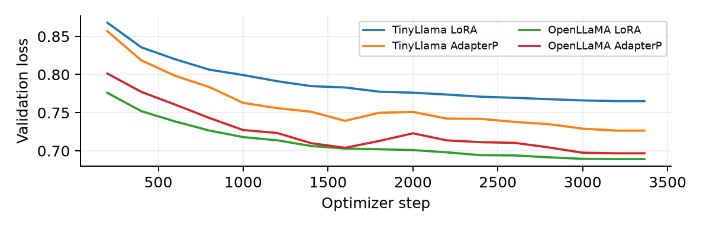

# 面向数学推理的 LLM 后训练

[English](README.md) | **简体中文**

本项目使用 **LoRA** 和 **AdapterP** 对 **TinyLlama 1.1B**、**OpenLLaMA 3B** 进行监督微调，构建从数据核验、GPU 训练、断点恢复到基准评估与错误分析的可复现实验流程。

**4 组训练 · 12 组完整评估 · 3,894 条已核验预测**

[英文报告 PDF](GPU/report/AI6130-Ass2-G2605698H.pdf) · [完整实验分析](docs/EXPERIMENT_REPORT.md) · [结果 CSV](GPU/results/final/summary.csv) · [权重与实验记录](https://github.com/hihihiddssa/LLM-Post-Training-for-Mathematical-Reasoning/releases/tag/experiments-2026-11-01)

## 工程实现

- 固定模型版本、数据哈希和训练/验证划分，统一四组训练的实验条件。
- 适配老师提供的 PEFT 实现，修复 Adapter 保存、加载及优化器与随机状态恢复。
- 定位 FP16 梯度非有限值问题，四组实验统一采用 BF16 基础权重与 FP32 Adapter 权重。
- 在 NSCC A100 集群上通过 PBS 运行作业，记录参数量、Loss、耗时和峰值显存。
- 实现可续跑且校验实验身份的逐题预测日志，保留原始输出、预测、标准答案及截断状态。
- 将答案提取复核与模型生成分开，保留原分数及全部逐题变更记录。

## 实验结果

每个配置均完成 **254 道 AQuA** 和 **395 道 AddSub**。AddSub 复核额外识别最后一行中明确、单一数值的结论句；规则统一应用于所有配置，不修改模型输出。

| 模型 | 方法 | 可训练参数 | AQuA 准确率 | AddSub 原评分 | AddSub 提取复核 |
|---|---|---:|---:|---:|---:|
| TinyLlama 1.1B | 未微调 | 0 | 0.00% | 0.00% | 0.00% |
| TinyLlama 1.1B | LoRA | 1,126,400 | **11.81%** | 8.61% | 18.23% |
| TinyLlama 1.1B | AdapterP | 23,068,672 | 11.02% | 5.57% | 17.47% |
| OpenLLaMA 3B | 未微调 | 0 | 0.79% | 2.03% | 2.03% |
| OpenLLaMA 3B | LoRA | 2,662,400 | 8.27% | 7.85% | **38.23%** |
| OpenLLaMA 3B | AdapterP | 42,598,400 | 10.24% | 7.34% | 29.87% |

### 主要发现

- **LoRA 在四项同模型对比中赢得三项。** OpenLLaMA + LoRA 的 AddSub 复核准确率最高，而其可训练参数仅为同模型 AdapterP 的 1/16。
- **不同基准的趋势不同。** OpenLLaMA 在 AddSub 复核结果上更好；TinyLlama 在两种方法下的 AQuA 准确率都更高。
- **验证 Loss 与答案准确率不总是一致。** TinyLlama AdapterP 的验证 Loss 更低，但两个基准的准确率均低于 LoRA。
- **答案提取会显著影响测量结果。** 复核从原始输出中恢复了 294 个正确答案；OpenLLaMA + LoRA 的 AddSub 正确题数从 31 增加到 151。
- **微调改变了输出行为。** 原始模型的所有输出均触及 256-token 上限；微调后的 AddSub 截断数降至每组 15–49 条。因此，基线对比同时反映当前提示词下的任务遵循、停止行为与答案正确性。



## 统一实验设置

| 项目 | 配置 |
|---|---|
| 训练数据 | math_7k 共 6,851 条；训练 6,731 / 验证 120 |
| 训练 | 2 Epoch；AdamW；学习率 3e-4；Warmup 100 步 |
| Batch 与长度 | 有效 Batch 4；Micro Batch 1；梯度累积 4；长度上限 256 |
| 可复现性 | 随机种子 42；固定模型版本及划分；每 200 步保存并验证 |
| LoRA | q_proj / v_proj；rank 8；alpha 16；dropout 0.05 |
| AdapterP | 项目自带 BottleneckConfig(use_adapterp=True)；宽度 256 |
| 硬件 | 每组使用一张 NVIDIA A100-SXM4-40GB；NSCC PBS |
| 精度 | BF16 基础权重 + FP32 Adapter；无量化；启用梯度检查点 |
| 推理 | 相同提示词；贪心解码；最多生成 256 token；KV Cache |
| 软件 | Python 3.12；torch 2.8.0+cu126；transformers 4.38.0；accelerate 0.28.0 |

每组训练耗时 **34.9–42.1 分钟**，峰值已分配显存 **2.24–7.33 GiB**。四组最终 Adapter 均按验证 Loss 选自第 3,200 步。完整指标及来源见 [summary.json](GPU/results/final/summary.json)。

## 复现方式

保留 `AI6130_Assignment2/` 与 `GPU/` 的同级目录结构，使用[固定依赖](GPU/requirements-compatible.txt)和老师仓库自带的 PEFT 实现。

```bash
cd GPU
python tools/audit.py
python tools/test_protocol.py
python tools/scoring_audit.py

# 分别替换为 tinyllama/openllama 与 lora/adapterp，在新实验目录运行。
python tools/train.py --model tinyllama --method lora --smoke
python tools/train.py --model tinyllama --method lora --resume
python tools/evaluate.py --run runs/main-tinyllama-lora-2ep --task AQuA
python tools/evaluate.py --run runs/main-tinyllama-lora-2ep --task AddSub

# 原始模型基线，不注入 Adapter。
python tools/evaluate_baseline.py --model tinyllama --task AQuA
python tools/evaluate_baseline.py --model tinyllama --task AddSub
```

[Colab Notebook](GPU/Assignment2-Colab.ipynb)、[集群脚本](GPU/cluster/)和[完整复现说明](GPU/README-completed.md)包含环境、作业提交、权重恢复与报告重建步骤。已验证的结果来自 A100；T4 候选配置需要另外进行 Smoke Test 和显存检查。

## 目录结构

```text
AI6130_Assignment2/          老师代码、PEFT 实现与指定数据集
GPU/tools/                  训练、评估、恢复与评分工具
GPU/configs/                统一实验配置
GPU/cluster/                PBS 作业脚本
GPU/artifacts/              模型版本、数据哈希及固定划分
GPU/collected/20261102/      原始预测与训练日志
GPU/results/final/          原评分、复核结果及逐题变更记录
GPU/report/                 PDF、可编辑报告、图表及检查记录
docs/EXPERIMENT_REPORT.md    完整英文实验分析
```

四组最终权重和完整实验归档见 [Release](https://github.com/hihihiddssa/LLM-Post-Training-for-Mathematical-Reasoning/releases/tag/experiments-2026-11-01)。源码、日志、预测和报告由 Git 管理；运行环境、缓存与认证文件不上传。

## 项目来源与 AI 使用

本项目基于 **NTU AI6130 Assignment 2**，在[老师仓库](https://github.com/duyngtr16061999/AI6130_Assignment2)基础上完成可复现流程、兼容性修复、完整基准实验及评分分析。项目范围为监督微调与 PEFT，来源与许可证见 [UPSTREAM.md](UPSTREAM.md)。

项目广泛使用 OpenAI Codex 协助实现、调试、集群流程、数据核验、分析和报告撰写。训练和生成在 NSCC GPU 上实际执行，所有报告指标均来自已保存的实验记录。
