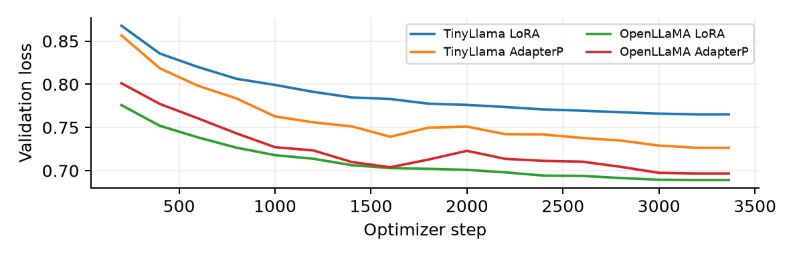

# AI6130 Assignment 2: Parameter-Efficient Fine-Tuning

A reproducible comparison of **LoRA** and **AdapterP** on **TinyLlama_v1.1** and **OpenLLaMA 3B v2**, evaluated on **AQuA** and **AddSub**.

**Completed:** 4 fine-tuning runs, 8 fine-tuned evaluations and 4 base-model evaluations. All **3,894** prediction records were verified against the unchanged datasets.

[Read the report (PDF)](../GPU/report/AI6130-Ass2-G2605698H.pdf) · [Editable report](../GPU/report/AI6130-Ass2-G2605698H.md) · [Results CSV](../GPU/results/final/summary.csv) · [Full metadata](../GPU/results/final/summary.json) · [Upstream attribution](../UPSTREAM.md)

The report is reproduced below as a GitHub-readable research summary. It presents original scores and a separate answer-extraction audit, together with actual parameter counts, losses, timings and error examples.

## 1. Introduction

This study compares LoRA and AdapterP on TinyLlama_v1.1 and OpenLLaMA 3B v2 for mathematical reasoning. Four adapters were trained on the same math_7k split and evaluated on AQuA and AddSub. Both original models were also evaluated, giving six model configurations and twelve complete benchmark evaluations. The comparison examines answer accuracy, trainable parameters, loss and output behavior.

## 2. Experimental setup

Data and models. The assigned math_7k.json contains 6,851 examples. A fixed Python seed-42 shuffle assigns 6,731 examples to training and 120 to validation. The test sets contain 254 AQuA and 395 AddSub questions. No exact normalized instruction overlap was found between math_7k and either test set. Test questions and reference answers were kept unchanged. Model IDs are TinyLlama/TinyLlama_v1.1 and openlm-research/open_llama_3b_v2; their Hugging Face revisions and dataset hashes are recorded in the accompanying metadata.

Adapters. The instructor's bundled PEFT implementation was used. LoRA targets q_proj and v_proj with rank 8, alpha 16 and dropout 0.05. AdapterP uses BottleneckConfig(use_adapterp=True), equivalent to --adapter_name bottleneck --use_adapterp, with bottleneck width 256, tanh activation and zero adapter dropout. Base weights remain frozen.

Training. All runs use two epochs, AdamW, learning rate 3e-4, 100 warmup steps, effective batch size 4, micro batch size 1, gradient accumulation 4, sequence cutoff 256 and seed 42. Loss covers the prompt and response tokens. Gradient checkpointing is enabled. Validation and checkpointing occur every 200 optimizer steps. Each run completes 3,364 steps; the final adapter is the lowest-validation-loss checkpoint, step 3,200 in all four runs.

Hardware and precision. Each experiment uses one NSCC NVIDIA A100-SXM4-40GB. Base weights use BF16 and trainable adapter weights FP32, without quantization. A training-item diagnostic found non-finite FP16 gradients and finite BF16 gradients, so BF16 was applied consistently. The environment uses Python 3.12, PyTorch 2.8.0+cu126, Transformers 4.38.0, Accelerate 0.28.0 and datasets 2.18.0.

Generation and scoring. All six configurations use the instructor's evaluation prompt, greedy decoding, one beam, a 256-token output cap and KV caching. This replaces the example's four-beam decoder and disabled cache. Only newly generated tokens are scored. AQuA requires an explicit A-E answer; AddSub uses numeric tolerance 0.001. Missing or ambiguous answers count as incorrect.

Answer extraction audit. The initial scorer accepts explicit answer markers but misses conclusions such as "Therefore, there are now 4 crayons." A separate audit accepts one numeric value in the final line when it is a complete conclusion beginning Therefore, Thus, Hence, So or Answer:. Equations, multiple values and conflicting explicit answers are rejected. This rule was applied uniformly to all stored outputs, without regeneration. Table 1 retains the original scores alongside the audited AddSub scores. AQuA scoring is unchanged.

## 3. Results

Table 1. Accuracy (%) on complete test sets. AddSub v1 is the original marker-based score; AddSub audit additionally recognizes the final conclusion described in Section 2. AQuA has 254 questions and AddSub has 395 questions per row.

| Model | Method | Trainable | AQuA | AddSub v1 | AddSub audit |
| --- | --- | --- | --- | --- | --- |
| TinyLlama | Base | 0 | 0.00 | 0.00 | 0.00 |
| TinyLlama | LoRA | 1.126M | 11.81 | 8.61 | 18.23 |
| TinyLlama | AdapterP | 23.069M | 11.02 | 5.57 | 17.47 |
| OpenLLaMA | Base | 0 | 0.79 | 2.03 | 2.03 |
| OpenLLaMA | LoRA | 2.662M | 8.27 | 7.85 | 38.23 |
| OpenLLaMA | AdapterP | 42.598M | 10.24 | 7.34 | 29.87 |

OpenLLaMA + LoRA produces the highest audited AddSub accuracy, 38.23% (151/395), followed by OpenLLaMA + AdapterP at 29.87% (118/395). TinyLlama + LoRA leads AQuA with 11.81% (30/254). Both baselines score below their corresponding fine-tuned models under the shared evaluation protocol.

The extraction audit changes 1,005 AddSub predictions and recovers 294 correct answers across the six configurations. For OpenLLaMA + LoRA, the count rises from 31 to 151 correct answers. The baseline scores do not change. These differences show that explicit answer formatting accounts for a substantial part of the original AddSub error count.

Table 2. Training and resource measurements. Train loss is the logged mean over training; validation loss is measured after reloading the selected checkpoint. Time includes the final validation and save. Memory is peak allocated GPU memory, rather than total device occupancy.

| Model / method | Trainable % | Train loss | Val. loss | Minutes | GPU GiB |
| --- | --- | --- | --- | --- | --- |
| TinyLlama / LoRA | 0.102 | 0.7996 | 0.7651 | 41.4 | 2.24 |
| TinyLlama / AdapterP | 2.054 | 0.6792 | 0.7265 | 34.9 | 2.60 |
| OpenLLaMA / LoRA | 0.078 | 0.7099 | 0.6891 | 42.1 | 6.66 |
| OpenLLaMA / AdapterP | 1.228 | 0.6316 | 0.6967 | 40.9 | 7.33 |

## 4. Comparison of methods and models

LoRA versus AdapterP. LoRA is higher on both TinyLlama benchmarks: +0.79 percentage points on AQuA and +0.76 points on audited AddSub. For OpenLLaMA, AdapterP is higher on AQuA by 1.97 points, while LoRA is higher on audited AddSub by 8.35 points. The method ranking therefore depends on the benchmark.

Model size. OpenLLaMA exceeds TinyLlama on audited AddSub by 20.00 points with LoRA and 12.41 points with AdapterP. TinyLlama is higher on AQuA with either method. Larger model size gives a clear advantage on AddSub in these runs, while AQuA remains dominated by low answer accuracy and frequent unfinished or invalid responses.

### Parameter efficiency, loss and output behavior

Parameter efficiency. AdapterP trains 20.48 times as many parameters as LoRA on TinyLlama and 16 times as many on OpenLLaMA. These extra parameters do not deliver a consistent accuracy gain. LoRA has the stronger parameter-to-performance trade-off here: it wins three of the four within-model benchmark comparisons, including the largest AddSub gain. AdapterP is faster in these runs, taking 34.9 versus 41.4 minutes on TinyLlama and 40.9 versus 42.1 minutes on OpenLLaMA.

Loss and accuracy. Validation loss decreases throughout most of training, as Figure 1 shows. TinyLlama AdapterP has lower validation loss than LoRA (0.7265 versus 0.7651) but slightly lower accuracy on both benchmarks. OpenLLaMA LoRA has the lowest validation loss (0.6891) and the best AddSub result, while AdapterP has the better AQuA result. Token prediction loss and final-answer accuracy thus measure different behavior.



Figure 1. Validation loss at saved evaluation steps. All final adapters were selected at step 3,200.

Table 3. Invalid-answer and generation-cap counts. Each cell reports invalid / cap-hit responses; the categories can overlap. AddSub invalid counts use the conclusion audit.

| Model | Method | AQuA invalid / cap | AddSub invalid / cap |
| --- | --- | --- | --- |
| TinyLlama | Base | 253 / 254 | 394 / 395 |
| TinyLlama | LoRA | 134 / 84 | 65 / 49 |
| TinyLlama | AdapterP | 113 / 76 | 51 / 15 |
| OpenLLaMA | Base | 238 / 254 | 375 / 395 |
| OpenLLaMA | LoRA | 132 / 97 | 26 / 21 |
| OpenLLaMA | AdapterP | 141 / 107 | 23 / 15 |

Output behavior. Every baseline response reaches the 256-token cap. OpenLLaMA produces whitespace-only output on 126 AQuA questions, and 342 of its 395 AddSub outputs trigger the repetition heuristic. Fine-tuning changes this behavior: AddSub cap hits fall to 15-49 per configuration. The baseline comparison therefore captures improved task-following and stopping behavior as well as answer correctness under this prompt.

## 5. Error analysis

Saved outputs distinguish arithmetic errors, reasoning errors, format errors and extraction errors. The examples below use the zero-based indices in the prediction journals; each remains traceable to the original question and gold answer.

Arithmetic error: OpenLLaMA + LoRA, AddSub 2. The question gives 12 games played and 4 defeats. The model chooses the correct operation but writes "12 - 4 = 10" and concludes 10 wins. The reference answer is 8. This is an incorrect calculation despite a suitable problem formulation.

Reasoning error: OpenLLaMA + AdapterP, AddSub 0. With 7 crayons initially and 3 removed, the model first computes 7 - 3 = 4 correctly, then adds 7 + 3 and concludes 10. The final answer is wrong because the model introduces an unnecessary second operation and replaces its correct intermediate result.

Extraction error: TinyLlama + AdapterP, AddSub 0. The model concludes "Therefore, there are now 4 crayons in the drawer." The answer is correct, but the original scorer returns no prediction because the output lacks an explicit numeric answer marker. The conclusion audit extracts 4 and marks it correct. This illustrates why a reasoning trace's last number and its declared final answer must be handled separately.

Format error: TinyLlama + LoRA, AQuA 2. The response ends with a numeric count of children rather than an A-E option. The AQuA scorer returns an invalid answer. A numeric conclusion does not supply the requested option label.

Repetition and truncation: TinyLlama + LoRA, AQuA 3. The model repeatedly restates the discounted price as 20 and reaches the generation cap without selecting an option. This is a generation failure before final-answer extraction.

Training length. At the 256-token training cutoff, 4,424 of 6,851 tokenized examples reach the cap for TinyLlama and 4,064 for OpenLLaMA. Long examples therefore lose later reasoning or answer tokens. A longer training context and more explicit final-answer supervision are concrete follow-up experiments. The current comparison uses one common seed and one hyperparameter setting per model-method pair; the reported gaps describe these completed runs.

## 6. Conclusion

LoRA offers the best overall parameter efficiency in this experiment. OpenLLaMA + LoRA is strongest on AddSub after conclusion extraction, reaching 38.23% with 2.662 million trainable parameters. TinyLlama + LoRA has the highest AQuA score at 11.81%. AdapterP improves OpenLLaMA's AQuA result but does not consistently benefit from its larger trainable parameter count. Fine-tuning substantially improves response behavior relative to the original models. Reliable comparison also requires recognizing explicit conclusions: the AddSub extraction audit recovers 294 correct answers from unchanged outputs.

## AI use declaration

OpenAI Codex was used extensively to implement and debug the experiment workflow, configure cluster jobs, develop answer-extraction rules, validate and summarize logs, and draft and format this report. Training and generation were executed on the NSCC GPUs. Reported measurements are derived from the saved experiment records.

## Sources and reproducibility

Instructor repository: github.com/duyngtr16061999/AI6130_Assignment2, commit 21086af375ddb6433e8dd00df0a28eeb5ce65d25. Models: TinyLlama/TinyLlama_v1.1 and openlm-research/open_llama_3b_v2. The accompanying package contains pinned revisions, data hashes and split indices, configuration, raw predictions, original and audited scores, training logs and final adapter weights.

## Repository layout

```text
AI6130_Assignment2/             Instructor source, bundled PEFT and assigned datasets
GPU/
  tools/                       Training, evaluation, scoring audit and report builders
  configs/                     Shared experiment settings
  cluster/                     PBS scripts for NSCC
  artifacts/                   Model revisions, data hashes and fixed split indices
  collected/20261102/runs/      Original predictions and completed training records
  collected/20261102/logs/      Training and benchmark logs
  results/final/               Verified summaries and separate audited predictions
  report/                      Four-page report plus cover, figure and QA metadata
  Assignment2-Colab.ipynb       Colab workflow
```

Final adapter weights and the complete evidence archive are attached to the [**experiments-2026-11-01** release](https://github.com/hihihiddssa/LLM-Post-Training-for-Mathematical-Reasoning/releases/tag/experiments-2026-11-01). Git stores the source, report, logs and predictions; model files stay in the release assets. Cluster passwords, SSH material, local environments and caches are excluded.

## Reproduce the experiments

The tested profile is **NVIDIA A100 40GB**, BF16 base weights and FP32 adapter weights, without quantization. Use the instructor's bundled `peft/`, rather than a separately installed modern PEFT package. See [environment requirements](../GPU/requirements-compatible.txt), [full workflow instructions](../GPU/README-experiments.md) and [completed experiment guide](../GPU/README-completed.md).

From `GPU/`, inside the dedicated training environment:

```bash
python tools/audit.py
python tools/test_protocol.py
python tools/smoke.py

# Repeat for tinyllama/openllama and lora/adapterp.
python tools/train.py --model tinyllama --method lora --smoke
python tools/train.py --model tinyllama --method lora --resume
python tools/evaluate.py --run runs/main-tinyllama-lora-2ep --task AQuA
python tools/evaluate.py --run runs/main-tinyllama-lora-2ep --task AddSub

# No adapter is injected in a baseline run.
python tools/evaluate_baseline.py --model tinyllama --task AQuA
python tools/evaluate_baseline.py --model tinyllama --task AddSub
```

`cluster/main.pbs` runs one training cell followed by its two benchmarks; `cluster/baseline.pbs` runs the two baseline benchmarks. Edit the account, paths and module names for another cluster. Use a fresh release directory to repeat a completed experiment: run identities prevent accidental overwriting. The same two-step checkpoint-resume check used before these experiments is in `cluster/resume-check.pbs`.

### Rebuild the evidence summaries and report

Download `experiment-delivery-20261102.tar.gz` from the repository release. From `GPU/`, unpack it into `collected/20261102/` to restore the final adapter files alongside the checked-in evidence:

```bash
mkdir -p collected/20261102
tar -xzf experiment-delivery-20261102.tar.gz -C collected/20261102
python tools/scoring_audit.py
python tools/finalize_results.py

# Use a separate report environment; this does not alter the training environment.
python -m pip install reportlab matplotlib pymupdf
python tools/build_report.py
```

The audit checks unique and complete sample coverage, dataset hashes, gold answers, original predictions and scores, and final adapter weight hashes. The extraction audit writes separate files; original output journals are retained. Report dependency versions are in [report-environment.json](../GPU/report/report-environment.json).

T4 execution is documented in the Colab workflow as a candidate profile requiring its own smoke and memory checks. The results above are from A100 runs.

## License and attribution

Instructor software and data licenses are retained in [AI6130_Assignment2/](../AI6130_Assignment2/). See [UPSTREAM.md](../UPSTREAM.md) for the source commit and the included dataset subset.
